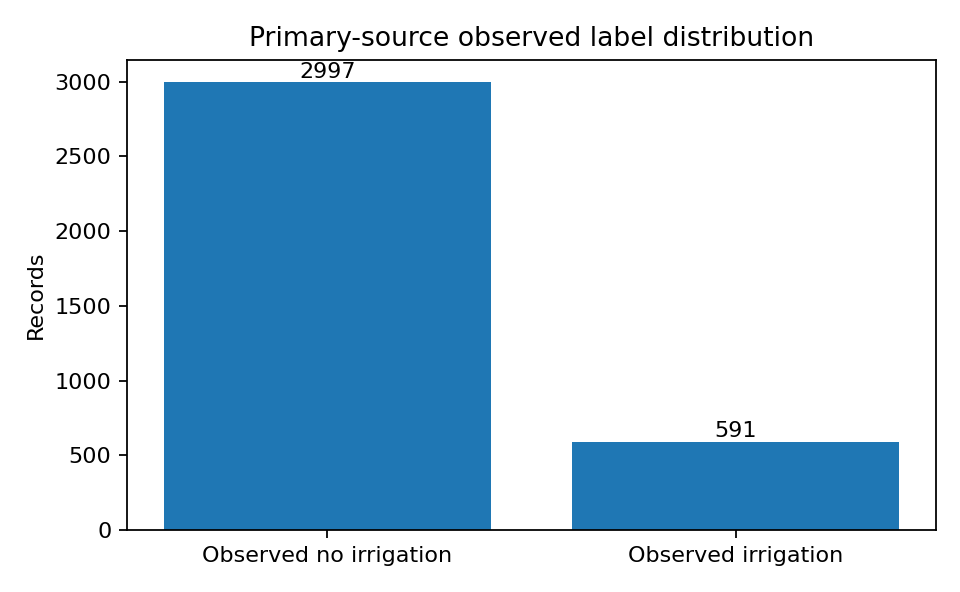
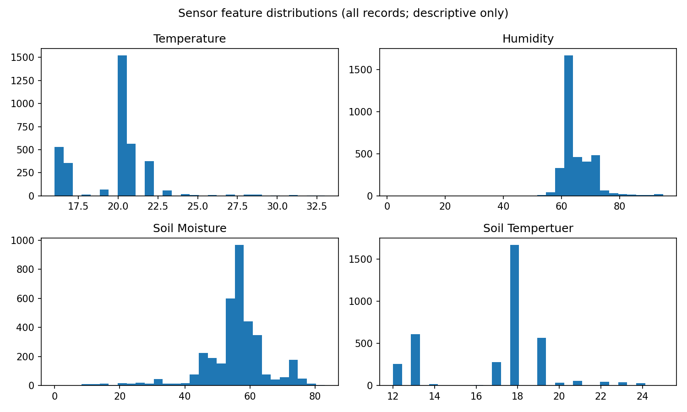
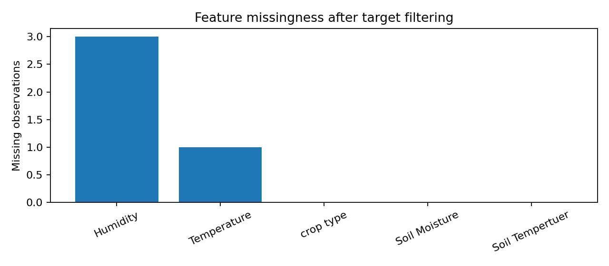
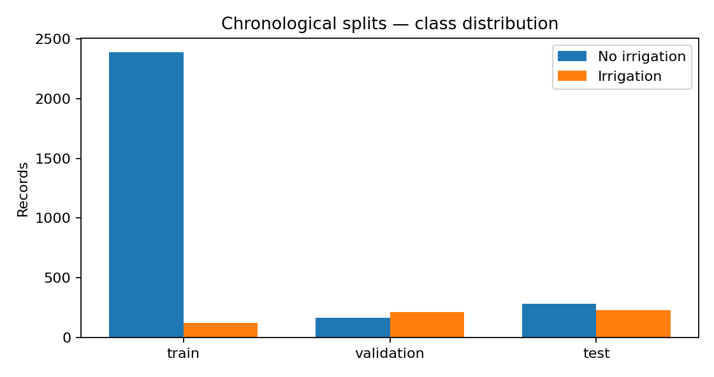
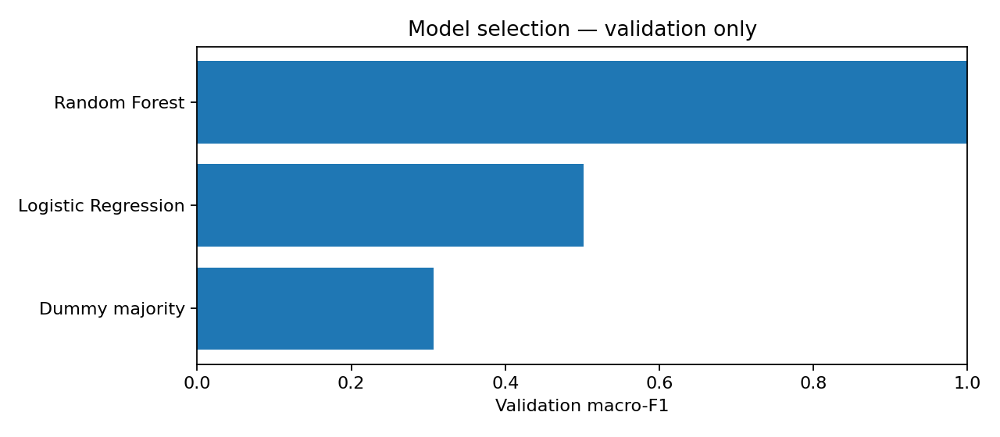
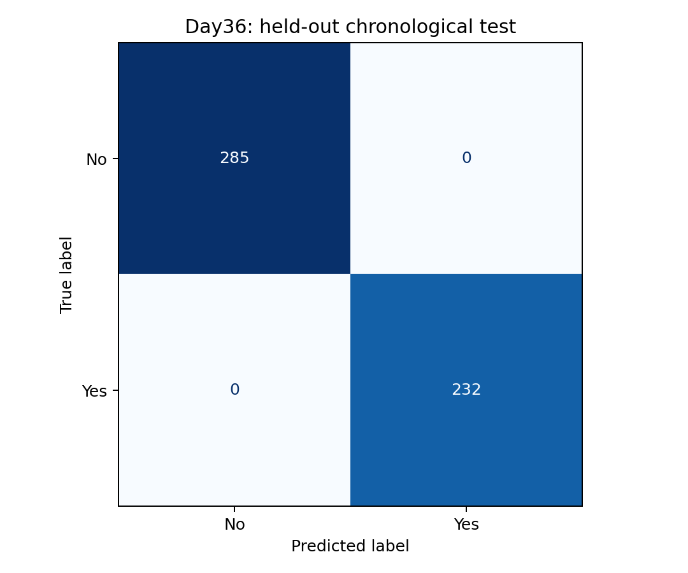

# IrrigationNeed

**Day 36 / 100 Days of Projects · Machine Learning · Smart Agriculture · Research Prototype**

[English documentation](docs/en/README.md) · [Dokumentasi Bahasa Indonesia](docs/id/README.md) · [Notebook](notebooks/irrigationneed.ipynb) · [Experimental evidence](reports/README.md) · [Full-stack setup](docs/FULLSTACK_SETUP.md)

> **Research scope:** IrrigationNeed reproduces the **source-recorded irrigation classification label** from environmental readings. It is not a validated crop-water-need estimator, irrigation schedule optimizer, irrigation controller, or field-tested recommendation system. This distinction matters even though the recorded in-source test score is perfect.

## Executive summary / Ringkasan eksekutif

IrrigationNeed is an end-to-end demonstration of an auditable ML pipeline and a local decision-support interface. The Kaggle notebook inventories five source families, trains a binary classifier on **one primary Excel workbook**, evaluates on a chronologically held-out partition, exports a scikit-learn pipeline, and connects that artifact to a FastAPI + React application. An audited GitHub snapshot contains the model, notebook, aggregate reports, plots, and frontend/backend source.

IrrigationNeed merupakan demonstrasi pipeline ML yang dapat diaudit dengan antarmuka dukungan keputusan lokal. Notebook Kaggle menginventarisasi lima kelompok sumber, tetapi **hanya satu workbook primer** yang digunakan untuk klasifikasi biner. Model hasil eksperimen kemudian digunakan oleh aplikasi FastAPI dan React. **Skor sempurna pada dataset sumber bukan validasi kebutuhan irigasi di lapangan.**

## Problem, users, questions / Masalah, pengguna, pertanyaan

Recorded sensor conditions and irrigation actions can be analyzed to understand whether a model can reproduce a dataset's labels. Target users are ML learners, researchers, and engineering reviewers—not unattended pump operators or farmers relying on automation. **Research question:** Can supervised models classify the recorded `irrigation` field under a chronological, exact-signature-purged split? **Not a claim:** that labels are ground-truth crop water requirements, or that outputs are safe actuation instructions.

## Implementation status (verified from GitHub tree)

| Capability | Status | Evidence / caveat |
|---|---|---|
| Dataset discovery and inventory | Implemented | Notebook, `reports/extracted/input_file_inventory.csv` |
| Chronological split and exact-signature purge | Implemented | `split_audit.csv`, `leakage_audit.json` |
| Three-model comparison and model export | Implemented | Notebook, validation CSV, `models/irrigation_champion.joblib` |
| Held-out within-source evaluation | Reported | 517 samples, see metrics; **external validity untested** |
| FastAPI prediction service | Implemented | `backend/app/main.py`; `GET /health`, `GET /model`, `POST /predict` |
| React dashboard | Implemented | `frontend/src/App.tsx`, local UI screenshot |
| Human-readable output and crop labels | Partial | Backend supports schema; **schema file absent** in audited repo |
| Automated tests, production deployment, live sensors | Not implemented / not verified | No test suite or deployment evidence found |
| Original dataset licensing and independent agronomic labels | Unverified | `dataset_provenance_pending_verification.json` |

## Before → Now → Next

| Stage | State | Deliverable and evidence |
|---|---|---|
| **Before** | Dataset discovery, source auditing, notebook design | Five source-family inventory; primary target chosen; auxiliary sources separated |
| **Now** | Research prototype and local full-stack demo | Exported Random Forest, FastAPI, React dashboard, plots, validation/test reports |
| **Next P0** | Verify labels and source rights | Publisher license, units, crop codes, collection/label protocol, target-rule audit |
| **Next P1** | Defensible external evaluation | Independent farm or collection period, near-duplicate audit, calibrated score study |
| **Next P2** | Engineering maturity | Schema mapping, unit-aware constraints, automated tests, CI, deployment hardening |

## System overview


The UI runs as a single-page application. It requests feature definitions from the backend, sends numeric feature values for prediction, and renders the raw label and optional `predict_proba` outputs. **No farm sensor integration, actuator control, database, or cloud inference is implemented.**

## Dataset provenance, definitions and processing

- **Primary dataset:** `second dataset collected.xlsx` from Kaggle mount `loliwibu/irrigationneed-dataset`; reported original source candidate: [Mendeley Data `67gkrzbwrr/1`](https://data.mendeley.com/datasets/67gkrzbwrr/1). Original license **not verified**. SHA-256 `f776f34fc9c7be1eef59614dc41ddeadef6fde9dc11d908c4ec8a513d6af4d2d`.
- **Raw records:** 3,589, with 3,588 labeled; source counts class 0: 2,997 and class 1: 591.
- **Five model input columns:** `crop type`, `Temperature`, `Humidity`, `Soil Moisture`, `Soil Tempertuer`. Exact spelling/case is required; no verified physical units or crop dictionary in this repo.
- **Target:** `irrigation`, class `0` = source-recorded no irrigation; class `1` = source-recorded irrigation. This is **not an agronomic necessity label**.
- **Excluded predictors:** `Time` (split only), `best time` (potential downstream leakage).
- **Missing data:** numeric coercion, remove missing/unexpected target, train-only median imputation in pipelines.
- **Auxiliary families:** Smart Irrigation Control, Environmental Sensor, Soil Moisture/Motor, Irrigation Actuator/Weather. **Audited only; not merged into primary labels**. Their labels are not interchangeable.
- **Rights:** input datasets are not committed; verify publisher attribution, permissions and version before redistribution.

For details in both languages, see [Provenance EN](docs/en/dataset_provenance.md) / [Asal dataset ID](docs/id/dataset_provenance.md), [Methodology EN](docs/en/methodology.md) / [Metodologi ID](docs/id/methodology.md).

## Dataset split and leakage audit

Chronological splitting uses distinct timestamp boundaries (70% / 15% / 15% approximate planning) and removes later-partition rows with identical sensor feature signatures. After purging: **train 2,511**, **validation 379**, **test 517**. There were **159 validation** and **22 test** rows purged; zero *exact* cross-split feature-signature overlap remained. No conflicting-label signature rows were quarantined. A farm-identity split or temporal near-duplicate exclusion **was not verified**.

| Split | Rows | Label 0 | Label 1 | Positive rate |
|---|---:|---:|---:|---:|
| Train | 2,511 | 2,388 | 123 | 4.90% |
| Validation | 379 | 168 | 211 | 55.67% |
| Held-out test | 517 | 285 | 232 | 44.87% |

The large class-distribution shift is itself an important limitation, not something to conceal.


*Recorded class distribution before final chronological splitting.*


*Sensor-variable histograms; descriptive evidence, not agronomic thresholds.*


*Missingness for model predictors after target filtering.*


*Class counts differ across chronological partitions.*

## Model selection and training

Three scikit-learn candidates were compared: Dummy majority baseline, Logistic Regression (median imputation and scaling), and Random Forest (median imputation). Validation **macro-F1** was the only primary champion criterion, with balanced accuracy as tie-breaker. Random Forest was selected using **validation** without refitting on test.

**Champion:** `RandomForestClassifier(n_estimators=300, min_samples_leaf=3, class_weight="balanced_subsample", n_jobs=-1, random_state=42)` within a fitted sklearn Pipeline. Training environment: Python 3.13.16, pandas 2.3.3, scikit-learn 1.6.1 (recorded in manifest).

| Model | Validation macro-F1 | Validation balanced accuracy | Validation accuracy |
|---|---:|---:|---:|
| Dummy majority | 0.3071 | 0.5000 | 0.4433 |
| Logistic Regression | 0.5012 | 0.5579 | 0.6016 |
| **Random Forest** | **1.0000** | **1.0000** | **1.0000** |


*Model selection was based on validation, not on the held-out test.*

## Held-out test and error analysis

**Source-reported held-out test:** n=517; accuracy **1.0000**, macro-F1 **1.0000**, balanced accuracy **1.0000**. Class 0 precision/recall/F1 = 1.000 with support 285; class 1 precision/recall/F1 = 1.000 with support 232. Confusion matrix (rows true, columns predicted, class order 0/1): `[[285, 0], [0, 232]]`. `heldout_error_counts.csv` records 517 correct and no errors.


*This result is **not** evidence of 100% future irrigation-need accuracy. See [limitations](docs/en/limitations.md) and [evaluation](docs/en/evaluation.md).*

**Interpretation:** A perfect score can coexist with strong serial dependence, a simple label-generating rule, source-specific conditions, or unrecognized non-exact leakage. The experiment verifies no *identical input signatures* across retained splits, but does **not** prove farm independence, no near-duplicates, no target circularity, or generalization beyond this source. Probabilities returned by `predict_proba` have **not** been calibrated.

## App screenshot / Tampilan aplikasi


*Actual local screenshot showing a successful inference request and class probability bars. A successful API response does not verify that the prediction is agronomically appropriate.*

## API and feature contract

The **backend** (`backend/app/main.py`) supports:

| Method | Endpoint | Behavior |
|---|---|---|
| GET | `/api/v1/health` | API status and readiness flags |
| GET | `/api/v1/model` | Model readiness, features, optional label mappings |
| POST | `/api/v1/predict` | Validated five-feature inference; prediction and optional per-class probabilities |

Example request using exact feature spelling (illustrative input, **not an irrigation prescription**):

```json
{
  "features": {
    "crop type": 3,
    "Temperature": 30,
    "Humidity": 65,
    "Soil Moisture": 35,
    "Soil Tempertuer": 28
  }
}
```

Output maps to the classifier's **source** labels: `0` means no-irrigation recorded, `1` means irrigation recorded. However, the current API displays **raw numeric labels** until optional `models/inference_schema.json` contains verified mappings. Sensor units and crop categories must not be guessed.

See [backend details](backend/README.md), [frontend details](frontend/README.md) and [API architecture](docs/en/architecture.md).

## Repository layout (audited)

```text
IrrigationNeed/
├── README.md                  # Project overview and evidence-linked claims
├── AGENTS.md                  # Working rules for code and AI agents
├── LICENSE                   # License not selected; do not assume open source
├── .env.example               # Example settings; MODEL_PATH currently unused by backend
├── .gitignore
├── assets/                   # Plots and genuine local app screenshot
│   ├── plots/
│   ├── screenshots/
│   ├── examples/
│   └── diagrams/
├── backend/
│   ├── app/main.py
│   └── requirements.txt
├── frontend/
│   ├── src/App.tsx
│   ├── src/style.css
│   ├── package.json
│   └── vite.config.ts
├── models/
│   └── irrigation_champion.joblib
├── notebooks/
│   └── irrigationneed.ipynb
├── reports/
│   ├── extracted/           # Aggregate metrics, validation, provenance, audit
│   └── extraction_manifest.json
├── docs/
│   └── FULLSTACK_SETUP.md
└── scripts/
    └── inspect_model.py
```

The bilingual `docs/en/` and `docs/id/` materials in this documentation update are **additions**, not original source tree contents. No datasets directory is created or tracked.

## Setup — Windows / local development

**Prerequisites:** trusted local model artifact, Python environment with FastAPI/pandas/sklearn/joblib dependencies, Node.js/npm; an available localhost port 8000 and 5173. The recorded research environment does not imply that the same pinned versions are installed locally.

Terminal 1 (PowerShell from `D:\porto\100 day\day 36`):

```powershell
& 'C:\DevEnvs\ai-general\Scripts\python.exe' -m pip install -r backend\requirements.txt
& 'C:\DevEnvs\ai-general\Scripts\python.exe' -m uvicorn backend.app.main:app --reload --port 8000
```

Terminal 2:

```powershell
cd 'D:\porto\100 day\day 36\frontend'
npm ci
npm run dev
```

Visit `http://127.0.0.1:5173` for the dashboard and `http://127.0.0.1:8000/docs` for API docs. To build the frontend: `npm run build` inside `frontend/`. The dashboard has been tested manually on one submitted five-feature input; there is no versioned automated API/UI test suite in the audited tree.

**Local example check:** class 0 was displayed for input `(crop type=3, Temperature=30, Humidity=65, Soil Moisture=35, Soil Tempertuer=28)`, with UI bars **79.9%/20.1%**. This is an observed UI output, **not a calibrated probability or agronomic judgment**.

## Model artifacts and integrity

`models/irrigation_champion.joblib` is a trusted local scikit-learn pipeline. The experiment manifest reports artifact SHA-256 `835ce8cfa81402276f0795197a5eff4fab064383b583a342cff91c9b01d80593`; compare your working file if doing audited reproduction. Python `joblib.load()` can execute code from a malicious pickle. Only load a verified artifact from a trusted publisher and never deserialize user uploads.

## End-to-end testing, security and deployment readiness

**Implemented checks:** FastAPI `POST /api/v1/predict` validates exact feature names, numeric/finite values and optional bounds; returns 422 for invalid payloads, 503 for unavailable model, 500 on model inference failures. The frontend fetches feature metadata and renders prediction/probabilities. **Unverified:** automated test suite, field correctness, runtime performance bounds, model calibration, security review, external deployment.

Development CORS allowlist includes localhost/127.0.0.1 Vite port 5173. No login, authorization, rate limiting, TLS, logging datastore or farmer permission workflow is implemented. Do not expose local development server publicly. `MODEL_PATH` is shown in `.env.example` but is **not read** by the backend's current constant model path. UI “Refresh model” refetches metadata; server restart is required to reload the artifact.

## Known limitations and claim boundaries

1. Source-recorded targets are **not independently validated water-need labels**; no quantitative irrigation schedule or volume is modeled.
2. Perfect within-source held-out score **does not establish** out-of-distribution performance; farm/site split and near-duplicate independence remain unverified.
3. Strong temporal class-distribution drift and potential deterministic label rules must be audited.
4. Model probabilities are not calibrated; class score is not safe decision confidence.
5. Sensor units, crop code names, licensing/attribution, and deployment safety protocol remain unresolved.
6. No production security, automated tests, cloud deployment or physical pump control was verified.

**Non-goals:** autonomous irrigation, claims of water savings/yield increases, calibrated agronomic risk, remote farming automation.

## Prioritized roadmap

| Priority | Work | Acceptance evidence |
|---|---|---|
| P0 | Verify original license and source class-generation protocol | Saved publisher statement, unit/crop dictionary, recorded date and version |
| P0 | Compare artifact SHA-256 and check label mapping | Trusted hash verification, optional schema reviewed against original source |
| P1 | Test farm-independent or prospective observations | External dataset provenance, explicit held-out farm/time splits, uncertainty intervals |
| P1 | Check near-duplicate/temporal autocorrelation and rule-proxy leakage | Reproducible independence and ablation report |
| P1 | Evaluate probability calibration and error costs | Calibration curve, Brier score, decision policy approved by domain expert |
| P2 | Automated API/UI tests, CI and security audit | Passing pytest, frontend build and end-to-end test logs |
| P2 | Controlled deployment pilot with human oversight | Deployment runbook, TLS/auth, monitoring, rollback, field expert sign-off |

## FAQ / Pertanyaan umum

**Is this a water-need predictor?** No; it classifies recorded binary irrigation states. / Tidak, targetnya label irigasi dari sumber.

**Does 100% test accuracy mean it will work in a field?** No; the split is internal to the source and farm-independent validation is unavailable. / Tidak, generalisasi lapangan belum terbukti.

**Can it control a pump?** No physical actuation endpoint or pump integration exists. / Belum ada kontrol pompa.

**Why are outputs still 0/1?** No verified inference label schema is committed. / Skema label terverifikasi belum tersedia di repo.

**Is it production deployed?** No; local development app only. / Masih aplikasi development lokal.

**Can I redistribute datasets and model?** Dataset licenses and code license remain unverified; review source rights first. / Hak distribusi dataset dan lisensi kode belum final.

## Troubleshooting and documentation navigation

- [Troubleshooting (EN)](docs/en/troubleshooting.md) / [Pemecahan masalah (ID)](docs/id/troubleshooting.md)
- [Methodology EN](docs/en/methodology.md) / [Metodologi ID](docs/id/methodology.md)
- [Evaluation EN](docs/en/evaluation.md) / [Evaluasi ID](docs/id/evaluation.md)
- [Architecture EN](docs/en/architecture.md) / [Arsitektur ID](docs/id/architecture.md)
- [Model card EN](docs/en/model_card.md) / [Kartu model ID](docs/id/model_card.md)
- [Reproducibility EN](docs/en/reproducibility.md) / [Reproduksibilitas ID](docs/id/reproducibility.md)
- [Deployment EN](docs/en/deployment.md) / [Deployment ID](docs/id/deployment.md)
- [Data provenance EN](docs/en/dataset_provenance.md) / [Asal dataset ID](docs/id/dataset_provenance.md)
- [Experiments EN](docs/en/experiments.md) / [Eksperimen ID](docs/id/experiments.md)
- [Limitations EN](docs/en/limitations.md) / [Keterbatasan ID](docs/id/limitations.md)

## License, attribution and references

The repository's current [`LICENSE`](LICENSE) explicitly says **license not yet selected**. This documentation update does not change that status or grant rights. The source dataset's original terms and attribution are likewise unverified (see provenance record). Third-party libraries have their own licenses; inspect them before redistribution or publication.

**References:** the [Kaggle dataset mount](https://www.kaggle.com/datasets/loliwibu/irrigationneed-dataset) used for the experiment, candidate [original Mendeley Data record](https://data.mendeley.com/datasets/67gkrzbwrr/1), [scikit-learn](https://scikit-learn.org/stable/), [FastAPI](https://fastapi.tiangolo.com/), [React](https://react.dev/), and the on-repository [experiment notebook](notebooks/irrigationneed.ipynb). External publication/licensing facts require independent verification.

**Maintainer:** [MENSTRUE](https://github.com/MENSTRUE) · **Documentation snapshot:** 2026-11-14. Experimental metrics and model claims originate from existing repo artifacts, not from inferred UI behavior.
