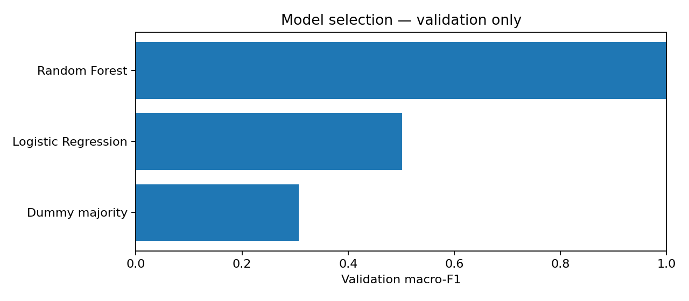
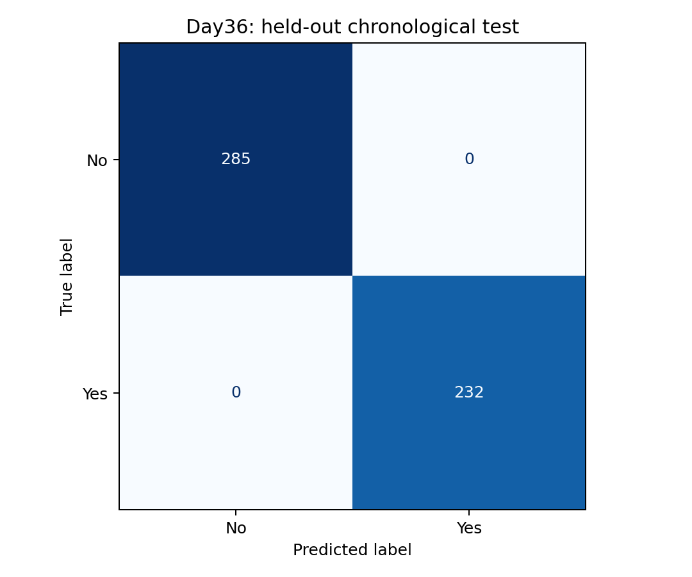

# Assets — original experiment plots and screenshots

Only existing visual evidence is embedded below. Do not invent results or produce placeholders to support claims. Plot files were exported from Kaggle notebook; screenshot documents a locally running frontend, not agricultural validity.

## Experiment plots
- [Recorded label distribution](plots/label_distribution.png) — labels before final split.
- [Missingness](plots/missingness.png) — input completeness.
- [Sensor feature distributions](plots/sensor_distributions.png) — descriptive feature histograms; units not verified.
- [Class balance per split](plots/split_class_balance.png) — temporal changes in class proportions.
- [Model comparison](plots/validation_models.png) — validation-only scores.
- [Held-out confusion matrix](plots/test_confusion_matrix.png) — n=517 source-specific test.

*Figure: validation-only model selection; Random Forest outperforms baselines in this source.*

*Figure: perfect observed test classification, which is not external field validity.*

## Real interface screenshot

*Figure: five-feature input with raw prediction and class-probability bars. The values are uncalibrated model output.*

## Directories and conventions
`plots/` for experiment-generated visual evidence, `screenshots/` for real app captures, `examples/` for verified example evidence only, and `diagrams/` for actual architecture diagrams when provided. Render images via repository-relative links, include dates and provenance where known, never use generic stock graphics as proof. Licensing of underlying datasets remains unresolved. See [evaluation](../docs/en/evaluation.md).
