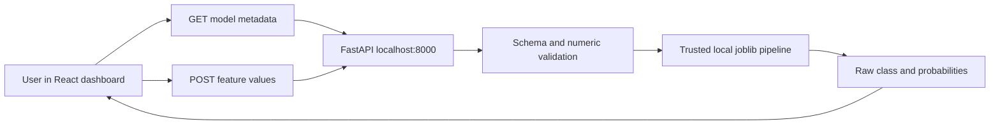

# Architecture — IrrigationNeed

## Implemented stack
**Frontend:** React 19, TypeScript, Vite 6, lucide-react; single-page dashboard with Overview, Prediction, Model Insights, dynamic input fields, result and class-probability bars. **Backend:** FastAPI, pandas, NumPy, sklearn/joblib; endpoints `GET /api/v1/health`, `GET /api/v1/model`, `POST /api/v1/predict`. **Model:** local `models/irrigation_champion.joblib`. Vite proxies `/api` to localhost:8000. CORS is restricted to Vite development origins. No authentication, database, cloud deployment, live sensor, or actuation is implemented.

## API contract
- `/api/v1/health`: `{status, model_status, model_ready}`. A healthy API is **not equivalent** to a correct prediction.
- `/api/v1/model`: `{ready, status, reason, model_name, features, prediction_labels, disclaimer}`. Feature metadata is derived from model `feature_names_in_` unless `models/inference_schema.json` overrides it.
- `/api/v1/predict`: JSON object `{"features":{"crop type":3,"Temperature":30,"Humidity":65,"Soil Moisture":35,"Soil Tempertuer":28}}` with **exact model feature keys**, returns `{prediction, display_label, model, class_probabilities?}`. Backend rejects missing/extra features (422), unavailable model (503), and reports inference failure (500).

## Architecture constraints
Model path is hard-coded from repo root; `.env.example` lists `MODEL_PATH` but current backend does **not** read that variable. `refresh()` fetches metadata again; it does **not** reload the joblib file server-side. The API has no production authentication, rate limits or audit storage.

## Evidence and interpretation
The experiment classifies the **source-recorded `irrigation` column**, not independently measured agronomic water need. The source did not establish a verified field-level irrigation prescription. The held-out 100% score is a *within-source, post-purge observation*, not prospective performance, robustness, or external validation. Exact sensor-signature de-duplication does not establish independent farms or remove near-duplicates. Probability calibration is untested.

## Evidence files
- [`experiment_manifest.json`](../../reports/extracted/experiment_manifest.json) — setup, features, split, model selection, hashes and limitations.
- [`heldout_test_metrics.json`](../../reports/extracted/heldout_test_metrics.json) — test metrics and confusion matrix.
- [`leakage_audit.json`](../../reports/extracted/leakage_audit.json) — exact-signature overlap.
- [`split_audit.csv`](../../reports/extracted/split_audit.csv) — counts and time periods.
- [`validation_model_comparison.csv`](../../reports/extracted/validation_model_comparison.csv) — validation-only selection.
- [`dataset_provenance_pending_verification.json`](../../reports/extracted/dataset_provenance_pending_verification.json) — unresolved source licensing.
