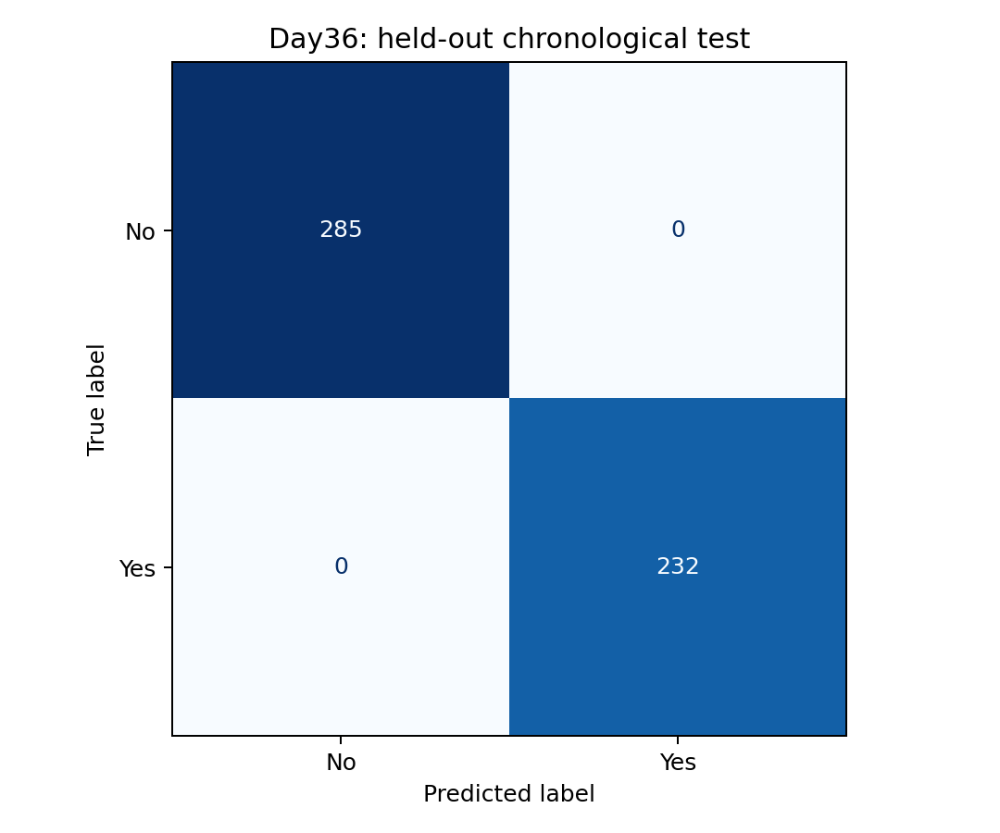

# Evaluation — IrrigationNeed

## Held-out test (reported, source-specific)
Selected model: Random Forest. **n=517**, accuracy **1.000**, macro-F1 **1.000**, balanced accuracy **1.000**. Per-class metrics: class 0 support 285 and class 1 support 232; both precision, recall and F1 reported as 1.000. The confusion matrix in source class order `[0,1]` is `[[285,0],[0,232]]`. No errors were reported for these 517 retained records.

*The observed test matrix is perfect; it does not establish out-of-distribution correctness.*

## Leakage and distribution review
The report states 159 validation and 22 test rows purged for exact feature-signature overlap. Zero exact overlap remains between train/validation/test. The number of contradictory-label rows quarantined is zero. Train spans 2022-12-30 03:56 to 2023-01-04 09:29; validation 2023-01-04 09:47 to 2023-01-05 12:23; test 2023-01-05 12:26 to 2023-01-06 15:20. Positive-class percentage changes **4.9% → 55.67% → 44.87%**. This shift makes performance interpretation especially important.

## Claim boundary
This is a held-out chronological **within-dataset** result, not a blind external test; repeated exploratory test use outside the notebook cannot be excluded. Nearby samples may correlate; deterministic control logic may make the label unusually easy to learn. Do not call these figures real-world irrigation-need accuracy. Do not treat 79.9% predicted probability on a single UI example as calibrated confidence.

## Evidence and interpretation
The experiment classifies the **source-recorded `irrigation` column**, not independently measured agronomic water need. The source did not establish a verified field-level irrigation prescription. The held-out 100% score is a *within-source, post-purge observation*, not prospective performance, robustness, or external validation. Exact sensor-signature de-duplication does not establish independent farms or remove near-duplicates. Probability calibration is untested.

## Evidence files
- [`experiment_manifest.json`](../../reports/extracted/experiment_manifest.json) — setup, features, split, model selection, hashes and limitations.
- [`heldout_test_metrics.json`](../../reports/extracted/heldout_test_metrics.json) — test metrics and confusion matrix.
- [`leakage_audit.json`](../../reports/extracted/leakage_audit.json) — exact-signature overlap.
- [`split_audit.csv`](../../reports/extracted/split_audit.csv) — counts and time periods.
- [`validation_model_comparison.csv`](../../reports/extracted/validation_model_comparison.csv) — validation-only selection.
- [`dataset_provenance_pending_verification.json`](../../reports/extracted/dataset_provenance_pending_verification.json) — unresolved source licensing.
