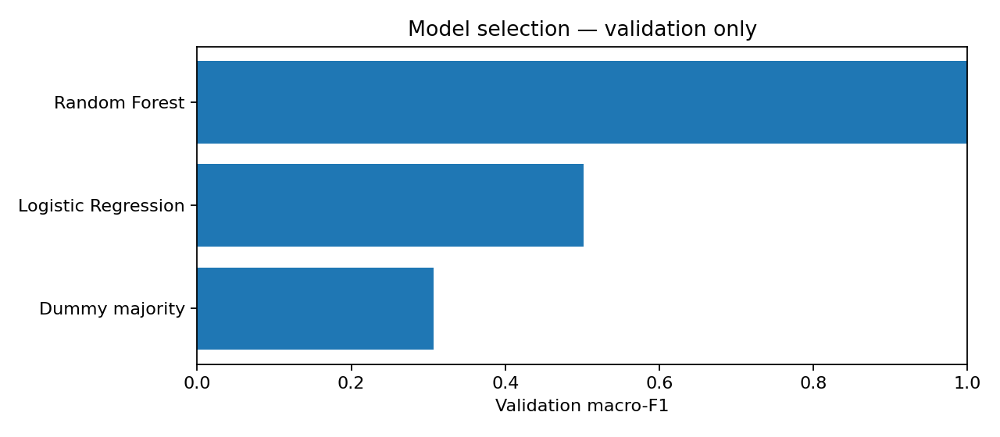
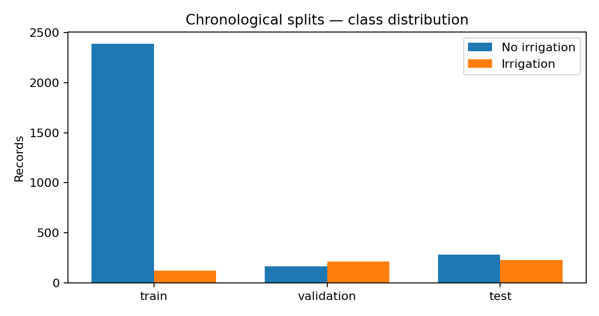

# Experiments — IrrigationNeed

## Baselines and selection
The notebook [`irrigationneed.ipynb`](../../notebooks/irrigationneed.ipynb) reports validation results below. Values are copied from the CSV evidence, not inferred from graphics.

| Candidate | Validation macro-F1 | Balanced accuracy | Accuracy |
|---|---:|---:|---:|
| Dummy majority | 0.307130 | 0.500000 | 0.443272 |
| Logistic Regression | 0.501233 | 0.557874 | 0.601583 |
| Random Forest | **1.000000** | **1.000000** | **1.000000** |

The Random Forest wins by validation macro-F1. Hyperparameter values are recorded in the notebook; the available evidence does not establish a broad hyperparameter-search process. The classification pipeline uses seed 42; Kaggle run versions are Python 3.13.16, pandas 2.3.3, scikit-learn 1.6.1.

## Diagnostic plots

*Validation comparison; not a test-set model selection.*

*Class proportions differ substantially across chronological periods.*

## Open experimental questions
A deterministic-label proxy, adjacent-record dependence, farm/site grouping, sensor coding, feature-value leakage through target-derived inputs, and probability calibration are untested. Next experiments should test a new farm or independent acquisition period, prespecified thresholds, and a truly external source with matching semantics.

## Evidence and interpretation
The experiment classifies the **source-recorded `irrigation` column**, not independently measured agronomic water need. The source did not establish a verified field-level irrigation prescription. The held-out 100% score is a *within-source, post-purge observation*, not prospective performance, robustness, or external validation. Exact sensor-signature de-duplication does not establish independent farms or remove near-duplicates. Probability calibration is untested.

## Evidence files
- [`experiment_manifest.json`](../../reports/extracted/experiment_manifest.json) — setup, features, split, model selection, hashes and limitations.
- [`heldout_test_metrics.json`](../../reports/extracted/heldout_test_metrics.json) — test metrics and confusion matrix.
- [`leakage_audit.json`](../../reports/extracted/leakage_audit.json) — exact-signature overlap.
- [`split_audit.csv`](../../reports/extracted/split_audit.csv) — counts and time periods.
- [`validation_model_comparison.csv`](../../reports/extracted/validation_model_comparison.csv) — validation-only selection.
- [`dataset_provenance_pending_verification.json`](../../reports/extracted/dataset_provenance_pending_verification.json) — unresolved source licensing.
