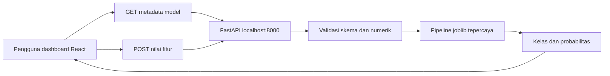

# Architecture — IrrigationNeed

## Stack yang diimplementasikan
**Frontend:** React 19, TypeScript, Vite 6, lucide-react; dashboard satu halaman dengan Overview, Prediction, Model Insights, input dinamis, hasil, dan grafik probabilitas. **Backend:** FastAPI, pandas, NumPy, sklearn/joblib; endpoint `GET /api/v1/health`, `GET /api/v1/model`, `POST /api/v1/predict`. **Model:** lokal `models/irrigation_champion.joblib`. Vite meneruskan `/api` ke localhost:8000. CORS terbatas pada origin Vite development. Belum ada autentikasi, database, cloud deployment, sensor langsung, atau aktuasi.

## Kontrak API
- `/api/v1/health`: `{status, model_status, model_ready}`. API sehat **bukan** bukti prediksi benar.
- `/api/v1/model`: `{ready, status, reason, model_name, features, prediction_labels, disclaimer}`. Metadata fitur dari `feature_names_in_` kecuali dioverride `models/inference_schema.json`.
- `/api/v1/predict`: JSON `{"features":{"crop type":3,"Temperature":30,"Humidity":65,"Soil Moisture":35,"Soil Tempertuer":28}}` dengan **nama fitur yang tepat**, mengembalikan `{prediction, display_label, model, class_probabilities?}`. Input kurang/lebih ditolak (422), model belum siap (503), kegagalan inferensi (500).

## Batasan arsitektur
Path model ditentukan dari root repository; `.env.example` berisi `MODEL_PATH` tetapi backend saat ini **tidak membaca** variabel tersebut. Tombol `refresh()` hanya memuat ulang metadata lewat API; **bukan** reload file joblib di server. API belum punya autentikasi production, rate limiting, ataupun audit log permanen.

## Bukti dan interpretasi
Eksperimen ini mengklasifikasikan **kolom `irrigation` yang dicatat sumber**, bukan kebutuhan air agronomis yang diukur secara independen. Makna label belum tervalidasi untuk resep irigasi lapangan. Skor held-out 100% adalah *hasil internal satu sumber setelah purge*, bukan bukti performa prospektif, ketahanan, atau validasi eksternal. Penghapusan duplikasi tanda tangan sensor yang identik tidak membuktikan independensi lahan atau menghilangkan near-duplicate. Kalibrasi probabilitas belum diuji.

## Berkas bukti
- [`experiment_manifest.json`](../../reports/extracted/experiment_manifest.json) — konfigurasi, fitur, split, seleksi model, hash, dan keterbatasan.
- [`heldout_test_metrics.json`](../../reports/extracted/heldout_test_metrics.json) — metrik dan confusion matrix test.
- [`leakage_audit.json`](../../reports/extracted/leakage_audit.json) — overlap fitur yang identik.
- [`split_audit.csv`](../../reports/extracted/split_audit.csv) — distribusi dan periode data.
- [`validation_model_comparison.csv`](../../reports/extracted/validation_model_comparison.csv) — seleksi berbasis validasi saja.
- [`dataset_provenance_pending_verification.json`](../../reports/extracted/dataset_provenance_pending_verification.json) — lisensi sumber belum dipastikan.
