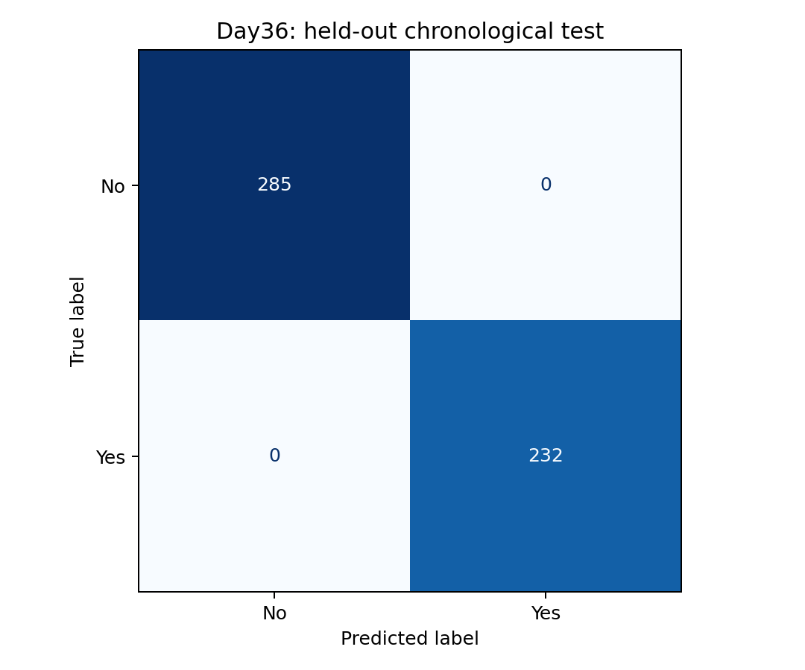

# Evaluation — IrrigationNeed

## Held-out test (sesuai laporan, satu sumber)
Champion: Random Forest. **n=517**, accuracy **1,000**, macro-F1 **1,000**, balanced accuracy **1,000**. Kelas 0 support 285 dan kelas 1 support 232; precision, recall, dan F1 keduanya dilaporkan 1,000. Confusion matrix dengan urutan kelas `[0,1]`: `[[285,0],[0,232]]`. Tidak ada error yang tercatat pada 517 sampel tersisa.

*Matriks test sempurna dalam sumber ini, tetapi tidak membuktikan kebenaran pada domain baru.*

## Audit leakage dan distribusi
Sebanyak 159 baris validasi dan 22 baris test dipurge karena signature input identik. Overlap eksak antarsplit menjadi nol; tidak ada baris yang dikarantina akibat label bertentangan. Train: 2022-12-30 03:56 sampai 2023-01-04 09:29; validasi: 2023-01-04 09:47 sampai 2023-01-05 12:23; test: 2023-01-05 12:26 sampai 2023-01-06 15:20. Persentase kelas positif berubah **4,9% → 55,67% → 44,87%**. Pergeseran tersebut wajib diperhatikan.

## Batas klaim
Ini hasil held-out kronologis **dalam dataset yang sama**, bukan blind external test; eksplorasi ulang test di luar notebook tidak dapat dipastikan. Rekaman bertetangga mungkin berkorelasi, dan aturan kontrol deterministik bisa membuat label mudah ditebak. Jangan sebut metrik ini akurasi kebutuhan irigasi di dunia nyata. Probabilitas 79,9% pada satu contoh UI juga bukan confidence terkalibrasi.

## Bukti dan interpretasi
Eksperimen ini mengklasifikasikan **kolom `irrigation` yang dicatat sumber**, bukan kebutuhan air agronomis yang diukur secara independen. Makna label belum tervalidasi untuk resep irigasi lapangan. Skor held-out 100% adalah *hasil internal satu sumber setelah purge*, bukan bukti performa prospektif, ketahanan, atau validasi eksternal. Penghapusan duplikasi tanda tangan sensor yang identik tidak membuktikan independensi lahan atau menghilangkan near-duplicate. Kalibrasi probabilitas belum diuji.

## Berkas bukti
- [`experiment_manifest.json`](../../reports/extracted/experiment_manifest.json) — konfigurasi, fitur, split, seleksi model, hash, dan keterbatasan.
- [`heldout_test_metrics.json`](../../reports/extracted/heldout_test_metrics.json) — metrik dan confusion matrix test.
- [`leakage_audit.json`](../../reports/extracted/leakage_audit.json) — overlap fitur yang identik.
- [`split_audit.csv`](../../reports/extracted/split_audit.csv) — distribusi dan periode data.
- [`validation_model_comparison.csv`](../../reports/extracted/validation_model_comparison.csv) — seleksi berbasis validasi saja.
- [`dataset_provenance_pending_verification.json`](../../reports/extracted/dataset_provenance_pending_verification.json) — lisensi sumber belum dipastikan.
