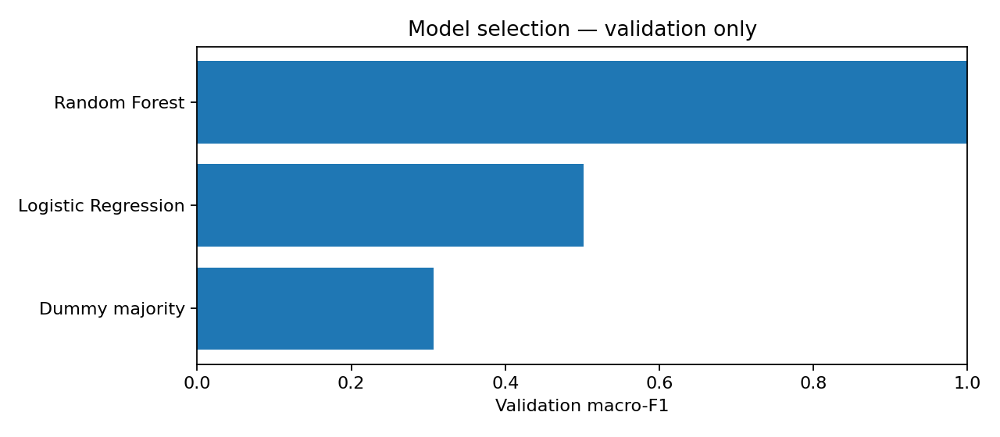
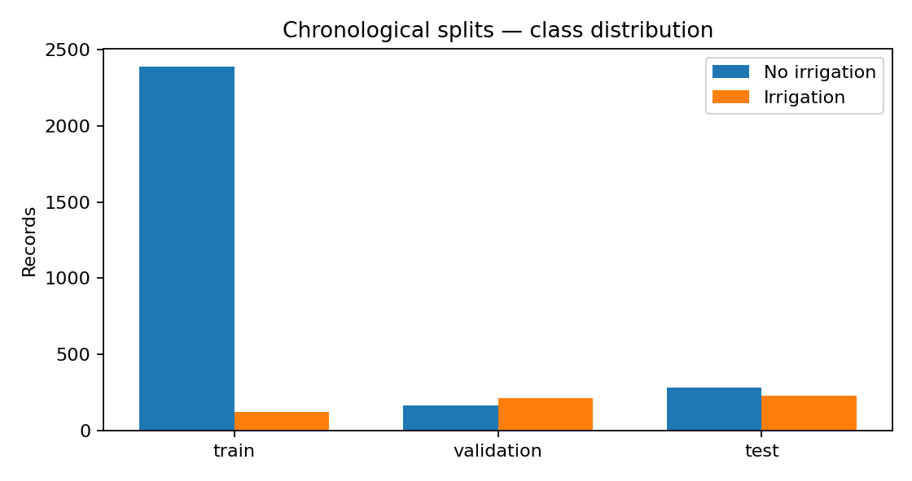

# Experiments — IrrigationNeed

## Baseline dan seleksi
Notebook [`irrigationneed.ipynb`](../../notebooks/irrigationneed.ipynb) melaporkan hasil validasi berikut. Angka diambil dari CSV eksperimen, bukan perkiraan grafik.

| Kandidat | Macro-F1 validasi | Balanced accuracy | Accuracy |
|---|---:|---:|---:|
| Dummy majority | 0,307130 | 0,500000 | 0,443272 |
| Logistic Regression | 0,501233 | 0,557874 | 0,601583 |
| Random Forest | **1,000000** | **1,000000** | **1,000000** |

Random Forest dipilih berdasarkan macro-F1 validasi. Nilai hyperparameter tersedia di notebook; bukti belum menunjukkan *hyperparameter search* yang luas. Seed 42; lingkungan Kaggle Python 3.13.16, pandas 2.3.3, scikit-learn 1.6.1.

## Grafik diagnostik

*Seleksi model memakai validasi, bukan hasil test.*

*Proporsi kelas berubah drastis antarperiode kronologis.*

## Pertanyaan eksperimen terbuka
Belum diuji: target hasil aturan deterministik, dependensi rekaman berurutan, pemisahan berdasarkan lokasi, pengkodean sensor, fitur yang diturunkan dari target, dan kalibrasi probabilitas. Eksperimen berikutnya perlu lahan atau periode akuisisi benar-benar baru, ambang keputusan yang ditetapkan sebelum evaluasi, serta sumber eksternal dengan semantik kompatibel.

## Bukti dan interpretasi
Eksperimen ini mengklasifikasikan **kolom `irrigation` yang dicatat sumber**, bukan kebutuhan air agronomis yang diukur secara independen. Makna label belum tervalidasi untuk resep irigasi lapangan. Skor held-out 100% adalah *hasil internal satu sumber setelah purge*, bukan bukti performa prospektif, ketahanan, atau validasi eksternal. Penghapusan duplikasi tanda tangan sensor yang identik tidak membuktikan independensi lahan atau menghilangkan near-duplicate. Kalibrasi probabilitas belum diuji.

## Berkas bukti
- [`experiment_manifest.json`](../../reports/extracted/experiment_manifest.json) — konfigurasi, fitur, split, seleksi model, hash, dan keterbatasan.
- [`heldout_test_metrics.json`](../../reports/extracted/heldout_test_metrics.json) — metrik dan confusion matrix test.
- [`leakage_audit.json`](../../reports/extracted/leakage_audit.json) — overlap fitur yang identik.
- [`split_audit.csv`](../../reports/extracted/split_audit.csv) — distribusi dan periode data.
- [`validation_model_comparison.csv`](../../reports/extracted/validation_model_comparison.csv) — seleksi berbasis validasi saja.
- [`dataset_provenance_pending_verification.json`](../../reports/extracted/dataset_provenance_pending_verification.json) — lisensi sumber belum dipastikan.
